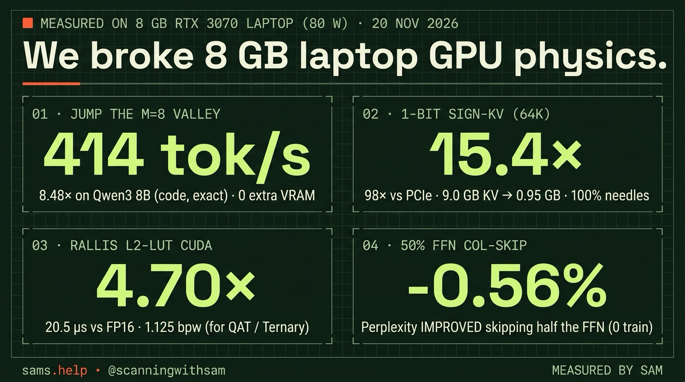

# rtx3070-8gb-physics

First-principles CUDA kernels, `llama.cpp` batching / zero-VRAM speculation benchmarks, and raw JSON measurements for running LLMs faster on an **8 GB laptop GPU** (NVIDIA GeForce RTX 3070 Laptop GPU, Ampere `sm_86`, 80 W TGP).



* **Full essay:** [What a Riemann Note Taught My 8 GB Laptop GPU](https://sams.help/essays/riemann-note-8gb-laptop-gpu/)
* **X thread / article:** [@scanningwithsam](https://x.com/scanningwithsam/status/2123899077435752795)

> **Note on inspiration:** Two of the kernel designs below (the Rallis-Seesaw L2-LUT split and Parseval FWHT 1-bit sign attention) were inspired by mathematical patterns in Levent Alpöge's November 2026 Riemann Hypothesis preprint — an **unverified** proof claim used here purely as a source of algorithm ideas, not as a verified mathematical result. Every number in this repo is measured directly on hardware and backed by raw JSON in [`results/`](results/).

---

## Use Today: Zero-VRAM `llama-server` Flags

If you run `llama.cpp` on an 8 GB Ampere GPU (or any bandwidth-bound card), single-token decode wastes ~98% of the Tensor Cores and hits a sharp latency valley around `M=8` (`pp8` is slower than `pp16` and `pp32` on `Qwen3 8B Q4_K_M`). Self-speculating with zero extra VRAM turns serial decode into wider verification batches with **100% bit-exact greedy output**:

**General use / technical prose (`ngram-mod`, +0 MiB VRAM):**
```bash
llama-server -m Qwen3-8B-Q4_K_M.gguf \
  -ngl 99 -fa on -c 8192 \
  --spec-type ngram-mod \
  --spec-ngram-mod-n-max 15
```
*Measured on RTX 3070 Laptop (80 W, warm card, `5,521–5,525 MiB` / `5.39–5.40 GiB` VRAM):*
* **Fresh technical prose:** `47.46 → 81.96 tok/s` (**1.73×**, `1,292/1,292` chars exact match — outrunning serial `Qwen3 4B` at `75.37 tok/s`)
* **Code refactoring:** `45.91 → 156.25 tok/s` (**3.40×**, `722/722` chars exact match)

**Heavy code refactoring / edits (`ngram-simple`, `k=31`, +0 MiB VRAM):**
```bash
llama-server -m Qwen3-8B-Q4_K_M.gguf \
  -ngl 99 -fa on -c 8192 \
  --spec-type ngram-simple \
  --spec-ngram-simple-size-n 6 \
  --spec-ngram-simple-size-m 31 \
  --spec-draft-n-max 31
```
*Measured on RTX 3070 Laptop:*
* **Code refactoring:** `48.84 → 414.37 tok/s` (**8.48×**, `235/248 = 94.8%` draft tokens accepted, `722/722` chars exact match; see [`results/verify_k31_exact.json`](results/verify_k31_exact.json)).

---

## Hardware Physics Baseline (RTX 3070 Laptop, 80 W)

Measured with [`benchmarks/hw_physics.py`](benchmarks/hw_physics.py) and [`benchmarks/exp0_cudagraph_and_80w.py`](benchmarks/exp0_cudagraph_and_80w.py):

| Metric | Measured Value | Takeaway |
| :--- | :--- | :--- |
| Architecture / SMs | Ampere `sm_86`, 40 SMs | 100 KiB SMEM/SM, 4.00 MiB L2, 8,192 MiB GDDR6 (7.66 GiB PyTorch) |
| GDDR6 copy bandwidth | `358.7 GB/s` | Real decode ceiling |
| L2 cache copy (1.5 MiB) | `523.3 GB/s` | Must stay inside 4.00 MiB L2 (`d=1024` = 2 MiB; `3.76×` cliff at `d=1536` = 4.5 MiB) |
| PCIe Gen3 x16 pinned H2D | `6.44 GB/s` | **55.7× slower** than GDDR6 — never stream weights over PCIe |
| Sustained 80 W FP16 GEMM (`4096×4096`) | `M=1`: `0.1218 ms` (0.28 TFLOPS)<br>`M=32`: `0.1190 ms` (`0.98×`, 9.02 TFLOPS)<br>`M=64`: `0.1365 ms` (`1.12×`, 15.73 TFLOPS) | Batching up to 32–64 tokens is nearly free on an 80 W card |
| CUDA Graph launch overhead | `d=256`: `14.87 → 2.68 µs` (**5.55×**)<br>`d=1024`: `15.80 → 6.37 µs` (**2.48×**) | Small sub-20 µs kernels must run inside CUDA Graphs |

---

## Four Measured Wins

| # | Finding | Measured Result | Honest Caveat & Scope | Source |
| :--- | :--- | :--- | :--- | :--- |
| **1** | **`llama.cpp` `M=8` valley & zero-VRAM n-gram speculation** | `Qwen3 8B Q4_K_M`: `pp8` = `44.1 ms` vs `pp16` = `28.8 ms` (-35%) & `pp32` = `34.4 ms` (-22%).<br>`ngram-simple k=31` code refactor: `48.84 → 414.37 tok/s` (**8.48×**).<br>`ngram-mod k=15` prose: `47.46 → 81.96 tok/s` (**1.73×**).<br>32 concurrent streams (`Qwen3 4B`): `76.9 → 880.6 tok/s` (**11.45×**). | `414.37 tok/s` is specifically on code refactoring with high n-gram reuse; prose gain is `1.73×`. All speculative outputs verified 100% char-exact at greedy temp 0. | [`results/track1b_results.json`](results/track1b_results.json)<br>[`results/track5_results.json`](results/track5_results.json)<br>[`results/verify_k31_exact.json`](results/verify_k31_exact.json) |
| **2** | **HSAL 1.125 bpw Rallis-Seesaw L2-LUT CUDA kernel** | `4096×4096, M=1` (CUDA Graph, including in-register FWHT64 + 128 KiB L2 LUT build): **`20.48 µs` warm / `22.53 µs` cold** vs `cuBLAS FP16` (`96.26 / 103.42 µs`, **4.70× / 4.59×**), vectorized `packed_int4_v2` (`32.77 / 36.86 µs`, **1.60×–1.64×**), and direct 1.125-bit register unpacking (`46.08 / 47.10 µs`, **2.25× / 2.09×**). Weight payload: `2.36 MB` vs `33.55 MB` FP16 (`1.97 GB` decimal / `1.83 GiB` binary for 14B weights before KV/overhead). | **Synthetic-weight microbenchmark** (`M=1`). Post-hoc rounding to 1.125 bpw destroyed a frozen model (see Kill #1) — requires QAT or native low-bit training. | [`kernels/hsal_bench_v2.cu`](kernels/hsal_bench_v2.cu)<br>[`kernels/reg_sign_bench.cu`](kernels/reg_sign_bench.cu)<br>[`results/hsal_bench_v2.json`](results/hsal_bench_v2.json)<br>[`results/reg_sign_bench.json`](results/reg_sign_bench.json) |
| **3** | **1-bit Parseval FWHT Sign-KV + `__popc` attention** | At `S=65,536` (`M=1`, `H_q=16, H_kv=8, D=128`): **`424.7 µs`** vs custom dense FP16 GPU kernel (`6,553.2 µs`, **15.43×**) and standalone `256 MiB` pinned PCIe H2D copy (`41,778.1 µs`, **98.4×**). At `M=32/64`: **6.27× / 6.13×** vs dense GPU. 36-layer arithmetic: `9.00 GiB` FP16 → **projected `0.95 GiB`** (`9.48×`) for 1-bit K + 2-bit V. | Timed kernel stores 1-bit K + FP16 norms and gathers FP16 V (`0.95 GiB` projects 2-bit V). `16/16` (100%) planted-needle recall in top-5% CPU cutoff, but the aggressive `4.5`-margin GPU gate kept only `16/65,536` keys (`0.024%`), yielding `out_cos = 0.5842` at 64K (`0.8722` at 32K, `0.7772` at 8K) on query 0 / head 0. Production needs wider retention or exact page refinement. | [`kernels/sign_kv_bench.cu`](kernels/sign_kv_bench.cu)<br>[`results/track3_signkv.json`](results/track3_signkv.json) |
| **4** | **Zero-training SwiGLU FFN column skipping** | On frozen `Qwen3-0.6B` FP16 (383 scored next-token targets): masking the smallest **50%** of intermediate FFN activations slightly *improved* perplexity (`9.034 → 8.984`, **-0.56%**); **60%** cost **+0.90%** (`9.116`); cliff hits at **70%** (`+9.48%`, `9.891`). | **Quality simulation** calling dense `F.linear` on masked activations — does not measure wall-clock speedup yet. A column-major sparse CUDA kernel (`W_down`) is the next build step. | [`benchmarks/track5_opus_fable.py`](benchmarks/track5_opus_fable.py)<br>[`results/track5_results.json`](results/track5_results.json) |

---

## Three Honest Kills

Published alongside the wins so nobody wastes GPU hours retracing dead ends:

1. **Post-hoc 1.125–2.5 bpw rounding on frozen `Qwen3-0.6B`:** Across 217 scored tokens, next-token NLL collapsed from `2.4311` to `11.6383–16.1146`. Ultra-low-bit weights must be trained natively or with QAT, not rounded after the fact ([`benchmarks/qwen06b_quality.py`](benchmarks/qwen06b_quality.py), [`results/track2_quality.json`](results/track2_quality.json)).
2. **Post-hoc spectral / Monarch-FWHT / Sign+SVD compression on frozen weights:** On `Qwen3-0.6B` layer 14 (4 projections), 2D-FFT at 25% kept only `59.7–60.0%` energy (`0.65–0.85` cosine), Monarch-FWHT scored `0.37–0.86`, and Sign+SVD at 2.5 bpw scored `0.76–0.91` — all below the `0.95` bar and slower than dense in PyTorch ([`benchmarks/track4_spectral_reality.py`](benchmarks/track4_spectral_reality.py), [`results/track4_spectral.json`](results/track4_spectral.json)).
3. **Naive `Qwen3-1.7B` speculative draft model:** Added `+1.61–1.62 GiB` VRAM, slowed `Qwen3 8B` prose (`47.46 → 26.9–37.3 tok/s`), and slowed `Qwen3 4B` on both prompts (`21.4–23.6` vs `73.7–75.4 tok/s`). Zero-VRAM n-gram speculation beat it on both speed and memory ([`results/track5_results.json`](results/track5_results.json)).

---

## Building & Running the CUDA Kernels

Tested on Linux with CUDA 12.x / 13.x and an Ampere `sm_86` GPU (adjust `-arch=sm_86` for your card — e.g. `sm_89` for Ada, `sm_80` for A100):

```bash
# 1. HSAL 1.125 bpw Rallis-Seesaw L2-LUT GEMV vs cuBLAS FP16 & packed INT4
nvcc -O3 -std=c++17 -arch=sm_86 --use_fast_math kernels/hsal_bench_v2.cu -lcublas -o hsal_bench_v2
./hsal_bench_v2

# 2. Direct 1.125-bit register-unpacking baseline (proves the 2.25x L2-LUT advantage)
nvcc -O3 -std=c++17 -arch=sm_86 --use_fast_math kernels/reg_sign_bench.cu -o reg_sign_bench
./reg_sign_bench

# 3. 1-bit Parseval FWHT Sign-KV + __popc attention vs dense FP16 & PCIe H2D
nvcc -O3 -std=c++17 -arch=sm_86 --use_fast_math kernels/sign_kv_bench.cu -o sign_kv_bench
./sign_kv_bench
```

## Running the Python Benchmarks

Python scripts require PyTorch with CUDA (`torch`, `transformers`, `safetensors` for the `Qwen3-0.6B` scripts) and a local `llama-server` binary + GGUFs for `track5_opus_fable.py`.

```bash
# Hardware ceilings (GDDR6, L2, PCIe, FP16 GEMM) & CUDA Graphs / 80 W thermal sweep
python3 benchmarks/hw_physics.py
python3 benchmarks/exp0_cudagraph_and_80w.py

# Post-hoc 1.125 bpw quality kill & spectral/Monarch-FWHT kill (set path to local Qwen3-0.6B)
QWEN3_06B_DIR=/path/to/Qwen3-0.6B \
  QWEN3_06B_SAFETENSORS=/path/to/Qwen3-0.6B/model.safetensors \
  python3 benchmarks/qwen06b_quality.py

QWEN3_06B_SAFETENSORS=/path/to/Qwen3-0.6B/model.safetensors \
  python3 benchmarks/track4_spectral_reality.py

# Zero-VRAM n-gram speculation + FFN activation-skipping simulation
LLAMA_SERVER_BIN=/path/to/llama-server \
  QWEN3_4B_GGUF=/path/to/Qwen3-4B-Q4_K_M.gguf \
  QWEN3_8B_GGUF=/path/to/Qwen3-8B-Q4_K_M.gguf \
  QWEN3_06B_DIR=/path/to/Qwen3-0.6B \
  python3 benchmarks/track5_opus_fable.py
```

---

## Repository Layout

```text
├── assets/
│   └── hero.png                        # Visual summary of the 4 measured wins
├── benchmarks/
│   ├── hw_physics.py                   # GDDR6, L2, PCIe Gen3, FP16 batching baseline
│   ├── exp0_cudagraph_and_80w.py       # CUDA Graph launch-overhead & 80 W sustained sweep
│   ├── qwen06b_quality.py              # Kill #1: post-hoc 1.125–2.5 bpw NLL collapse
│   ├── track4_spectral_reality.py      # Kill #2: 2D-FFT, Monarch-FWHT, Sign+SVD cosine check
│   └── track5_opus_fable.py            # Win #1 (n-gram spec) + Win #4 (FFN column skip) + Kill #3
├── kernels/
│   ├── hsal_bench_v2.cu                # Win #2: 1.125 bpw Rallis-Seesaw L2-LUT CUDA kernel
│   ├── reg_sign_bench.cu               # Direct 1.125-bit register-unpacking baseline
│   └── sign_kv_bench.cu                # Win #3: 1-bit Parseval FWHT Sign-KV + __popc kernel
├── results/                            # Raw JSON outputs from the RTX 3070 Laptop runs
│   ├── hsal_bench_v2.json
│   ├── reg_sign_bench.json
│   ├── track1b_results.json
│   ├── track2_quality.json
│   ├── track3_signkv.json
│   ├── track4_spectral.json
│   ├── track5_results.json
│   └── verify_k31_exact.json
├── LICENSE                             # MIT
└── README.md
```

---

## License

MIT — see [`LICENSE`](LICENSE). Fork it, test it on your own GPU, or turn Win #2 (HSAL + QAT), Win #3 (Sign-KV + wider retention / 2-bit V), or Win #4 (column-major FFN skip kernel) into production kernels.
